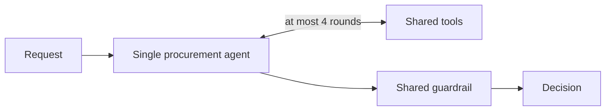
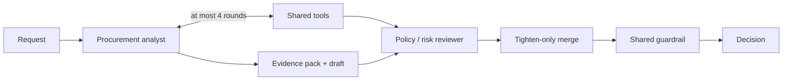

# Architecture

## Product boundary

The copilot is an evidence-gathering and recommendation system. It never
purchases software, approves a request, changes a budget, accepts legal terms,
or overrides Security, Privacy, Legal, Finance, or Procurement. Deterministic
code owns policy thresholds and calculations; the model interprets context and
writes an evidence-grounded recommendation; humans retain authority.

The policy reference date is **2026-09-30**, so expiry checks do not depend on
the machine clock.

## Shared core

```mermaid
flowchart LR
    U[UI / CLI / evaluation] --> A[analyze(request, architecture)]
    A --> T[Shared tool registry]
    T --> B[Budget check]
    T --> C[Catalog / purchase history]
    T --> V[Vendor-risk service + registry]
    T --> P[Approval router / policy lookup]
    A --> G[Shared code guardrail]
    G --> D[Validated Decision]
    D --> H[Human review / simulated handoff]
```

All tools return the same envelope: `ok`, `tool`, `result_id`, `data`,
`source`, `as_of`, and `error`. A failed tool is evidence of uncertainty, not
a favourable answer. Every Decision evidence item names the envelope it relies
on; the guardrail removes ungrounded material.

The deterministic findings layer recomputes approval requirements, risk flags,
the severity floor, and policy-driven recommendation. The guardrail uses the
maximum of model and code severity, so a model can tighten but never loosen a
rule. Missing, expired, conflicting, or unavailable vendor evidence forces the
appropriate human path.

## Architecture A — single-agent baseline



The agent may choose structured tool calls, then submits a structured decision.
Its temperature is zero. Tool arguments are closed, structured objects. Prompt
text treats request, catalog, and vendor prose as fenced business data rather
than instructions.

## Architecture B — analyst plus tighten-only reviewer



The analyst is the only B-stage agent with business tools. The reviewer sees
the evidence pack and raw envelopes, but has no business tools and can only
submit severity, additional risk flags, and missing-information additions.
Code enforces the constraint through maximum severity and union operations;
the prompt alone is not trusted. A reviewer failure leaves the analyst draft
to pass through the same shared guardrail.

## LLM reliability and reproducibility

`core.llm_client` owns provider configuration, call/tool counts, latency,
per-run call budget, requests-per-minute throttle, jittered exponential retry
for 429/5xx responses, and disk caching. Provider selection is a registry
entry: Gemini uses Google's official `google-genai` SDK, and the OpenAI-compatible
adapter serves OpenAI, OpenRouter, Groq, Together and Ollama, so changing
providers is configuration rather than an architectural rewrite. The cache key
includes provider, model, base URL, messages, tool definitions, schema and
temperature. Cache hits remain counted as calls for honest trace reporting, and
a cache hit needs no API key, so a clean checkout reproduces the published
numbers offline. Provider construction is lazy, so nothing validates a key
until a real call is due.

If the provider is unavailable or structured output cannot be repaired, the
system produces a safe human-review fallback. It does not invent data or
silently approve.

## Assumptions recorded from the starter pack

* `department_budgets.csv.available_usd` is authoritative. Purchase history is
  incomplete and only supports catalog/expansion evidence.
* An empty requested-integrations list means none supplied, not that a request
  is inherently safe.
* A missing department-head identity is surfaced as unresolved; no person is
  guessed.
* Catalog overlap supplies candidates and rationale, never an automatic
  duplicate/rejection verdict.
* The live vendor-risk service is the vendor security system of record, while
  the registry remains evidence that may reveal conflict. A review older than
  365 days or without a date is invalid.

The detailed inspection log, real data schema, and policy transcription are in
[`starter_pack_issues.md`](starter_pack_issues.md).
